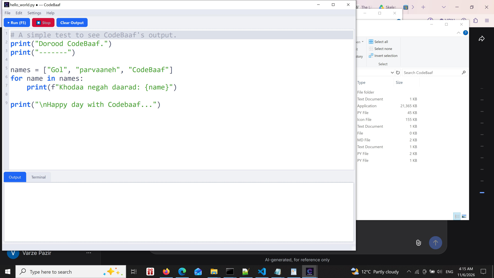
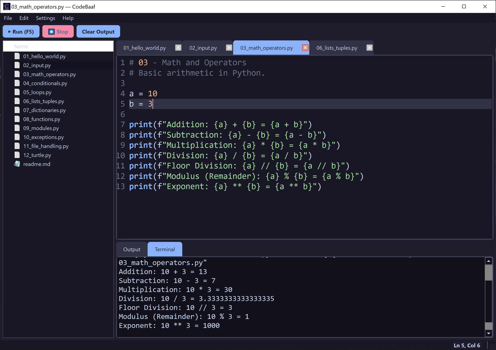
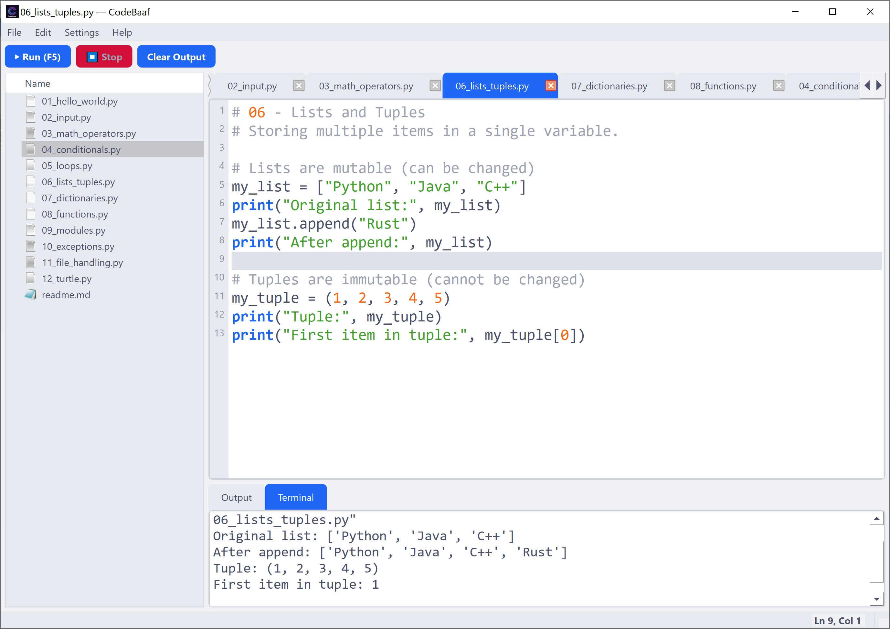

# CodeBaaf (شناسه‌باف) v0.1

**CodeBaaf** (شناسه‌باف) is a lightweight, modern, and open-source Python IDE built with PySide6. It is designed for speed, simplicity, and a beautiful coding experience. The name "CodeBaaf" comes from the Persian word "Baaf" (باف), meaning to weave—because here, you weave your code into reality.

---

## ✨ Features | رُخسارها

### 🌟 Core Features (from v0.0)
- 🎨 **Modern Dark/Light Theme**: Easy on the eyes for long coding sessions.
- ⚡ **Syntax Highlighting & Auto-complete**: Write Python faster.
- ▶️ **Run Code Instantly**: Execute your code with `F5`.
- 💻 **Integrated Terminal**: Real `cmd.exe` interaction with `input()` support.
- 🪟 **Standalone Executable**: Available for Windows users.

### 🚀 New Features in v0.1
- 📂 **File Explorer**: Navigate your projects with a built-in sidebar. Open/Close folders easily.
- 📝 **Multi-Tab Editing**: Open and manage multiple files at once without losing your place.
- 📐 **Auto-Indent & Indent Guides**: Smart indentation after `:` and beautiful vertical lines to keep your blocks organized.
- ⌨️ **Powerful Shortcuts**: 
  - `Ctrl+D` (Duplicate Line)
  - `Alt+Up/Down` (Move Line)
  - `Ctrl+/` (Toggle Comment)
  - `Ctrl+Scroll` (Zoom In/Out)
- 🛠️ **Auto-Fix Tabs**: Converts tabs to spaces automatically on run to prevent `TabError`.
- 📊 **Status Bar**: Real-time Line and Column indicator (`Ln 1, Col 1`).

---

## 🚀 Getting Started (from Source) | آغازکار (از سرچشمه

### Prerequisites | پیش‌نیازها
- Python 3.8 or higher
- PySide6

### Running the Open-Source Version
To run the open-source version, clone the repository and run `codebaaf-opensource.py`:

1. Clone the repository:
   ```bash
   git clone https://github.com/ostad-ai/CodeBaaf.git
   cd CodeBaaf
   ```
2. Install dependencies:
   ```bash
   pip install -r requirements.txt
   ```
3. Run the open-source IDE:
   ```bash
   python codebaaf-opensource.py
   ```

---

## 📥 Download the Executable | بارگیری پچین پساختی

You can download the standalone `.exe` version directly from the **Releases** page. No Python installation is required. Simply extract the `.zip` file and run `CodeBaaf.exe`.

**[Click here to download CodeBaaf v0.1 for Windows](https://github.com/ostad-ai/CodeBaaf/releases/tag/v0.1)**

*(Note: The open-source version is `v0.0` and can be run from the source code. The `v0.1` release includes advanced features like File Explorer and Multi-Tab).*

---

## 🧪 Sample Scripts | نویسک‌های نمونه

We have included **12 progressive Python tutorials** in the [samples](./samples/) folder. Whether you are a beginner or looking to test CodeBaaf's terminal, these scripts cover everything from basic variables to drawing with `turtle`. All scripts use only Python's built-in libraries! No extra dependencies required.

ما **۱۲ نویسک آموزشی پایتون** در پوشه [samples](./samples/) جای داده‌ایم. این نویسک‌ها از پایه تازه‌کار تا پیشرفته هستند، و همگی تنها از نسکخانه‌های درونی پایتون بهره‌گیری می‌کنند.

### 🟢 Beginner | تازه‌کار
1. `01_hello_world.py` - Basic print statements and variables.
2. `02_input.py` - Getting user input via the Terminal.
3. `03_math_operators.py` - Basic math operations.

### 🟡 Intermediate | میان‌پایه
4. `04_conditionals.py` - If, Elif, and Else statements.
5. `05_loops.py` - For and While loops.
6. `06_lists_tuples.py` - Working with lists and tuples.
7. `07_dictionaries.py` - Storing data in key-value pairs.
8. `08_functions.py` - Defining and calling functions.

### 🔴 Advanced & Modules | پیشرفته و سَنجانه‌ها
9. `09_modules.py` - Using built-in modules like `math` and `random`.
10. `10_exceptions.py` - Try-except blocks for error handling.
11. `11_file_handling.py` - Reading and writing files.
12. `12_turtle.py` - A fun drawing test using Python's built-in `turtle` module.

*(To test these, open CodeBaaf, load a script, and press **F5** to run it in the Terminal!)*

---

## ⭐ Support the Project | پشتیبانی از پروژه

If you find **CodeBaaf** useful, or if it brings a little joy to your coding journey, you may consider giving it a **Star** ⭐. 

Your stars are the light that keeps this project shining and motivate us to build more! 

اگر **شناسه‌باف** برایتان سودمند بود، یا اندکی به آروین برنامه‌نویسی شما شادی بخشید، میتوانید با دادن یک **ستاره** ⭐ از این پروژه، پشتیبانی کنید.

---

## 📜 License
This project is licensed under the MIT License - see the [LICENSE](LICENSE) file for details.

---

<table>
<tr>
<td>
Figure 1. A snapshot of the CodeBaaf, version 0.0, dark mode.
</td>
<td>
Figure 2. A snapshot of the CodeBaaf, version 0.0, light mode.
</td>
</tr>
Figure 3. A snapshot of the CodeBaaf, version 0.1, dark mode.
</td>
<td>
Figure 4. A snapshot of the CodeBaaf, version 0.1, light mode.
</td>
</tr>
</table>

---
