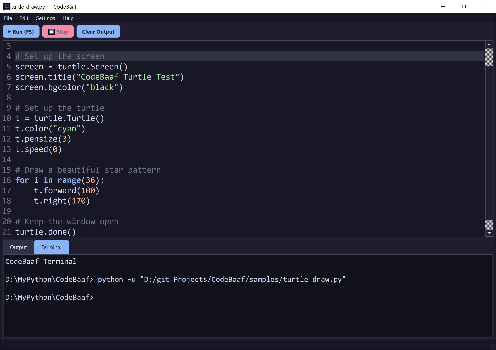

# CodeBaaf (شناسه‌باف) v0.0

**CodeBaaf** is a lightweight, modern, and **open-source** Python IDE. It is designed to be simple, beautiful, and fast. Perfect for quick scripting, learning Python, or building small projects.

---

## ✨ Features | رُخسارها

- 🎨 **Modern Dark/Light Theme**: Easy on the eyes.
- ⚡ **Syntax Highlighting & Auto-complete**: Write Python faster.
- ▶️ **Run Code Instantly**: Execute your code inside the terminal or output tab.
- 📝 **Integrated Terminal**: Real `cmd.exe` interaction with `input()` support.
- 📂 **File Manager**: Open, save, and manage your `.py` files easily.
- 🪟 **Standalone Executable**: Available as a `.exe` for Windows users (no Python installation required).

---

## 🚀 Getting Started | آغاز کار

### Prerequisites | پیش‌نیازها
- Python 3.8 or higher
- PySide6

### Installation (from Source) | درنشاندن از چشمه
1. Clone the repository:
   ```bash
   git clone https://github.com/ostad-ai/CodeBaaf.git
   cd CodeBaaf

---

## 📥 Download the Executable | بارگیری پچین پساختی

You can download the standalone `.exe` version directly from the **Releases** page. No Python installation is required.

**[Click here to download CodeBaaf v0.0 for Windows 10 and over](https://github.com/ostad-ai/CodeBaaf/releases/tag/v0.0)**

---

## 🧪 Sample Scripts | اسکریپت‌های نمونه

We have included three sample Python scripts in the [samples](./samples/) folder to test CodeBaaf. You can download them directly from the repository or use the standalone `.exe` to open and run them.

1. **`hello_world.py`** - Basic print statements (No extra libraries).
2. **`input_test.py`** - A script to test terminal input and `input()` functionality.
3. **`turtle_draw.py`** - A simple drawing using Python's built-in `turtle` module (No extra libraries).

---

<table>
<tr>
<td>
<br>Figure 1. A snapshot of the CodeBaaf, version 0.0
</td>
</tr>
</table>

---
